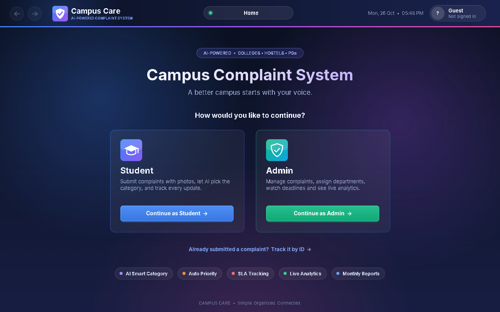
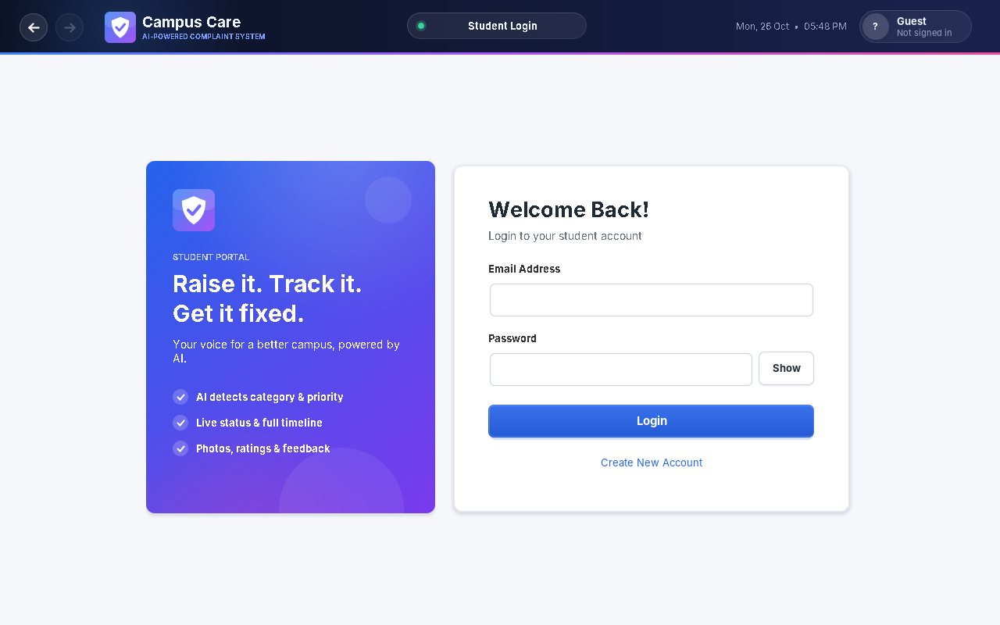
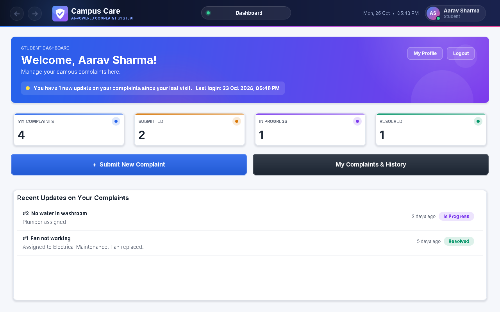
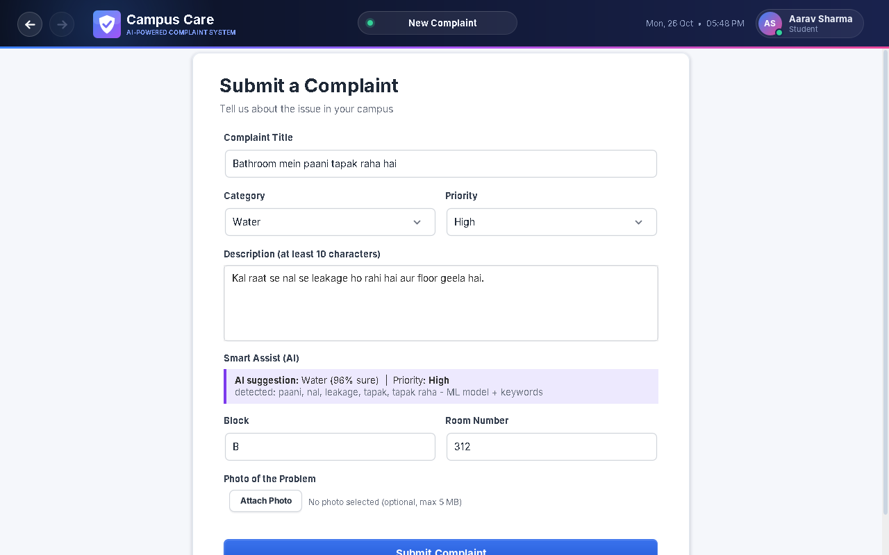
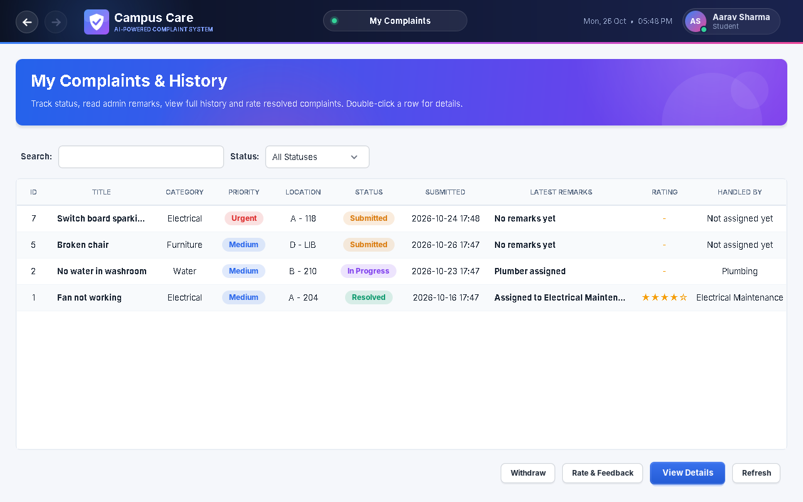
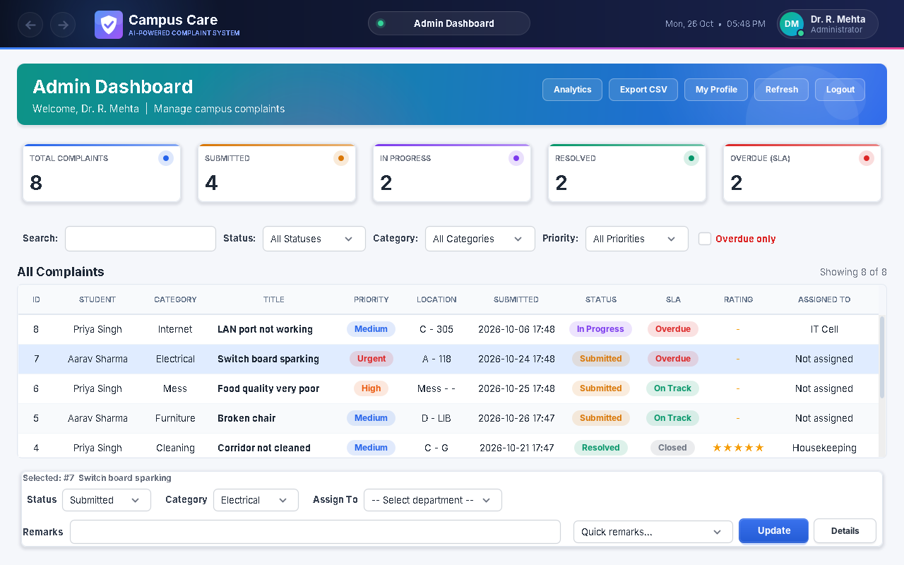
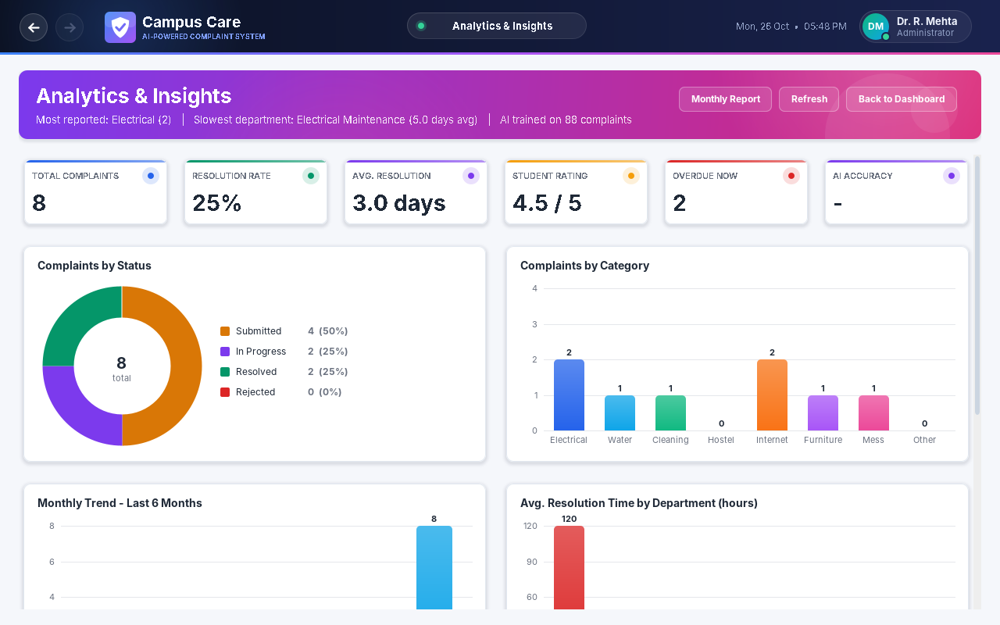
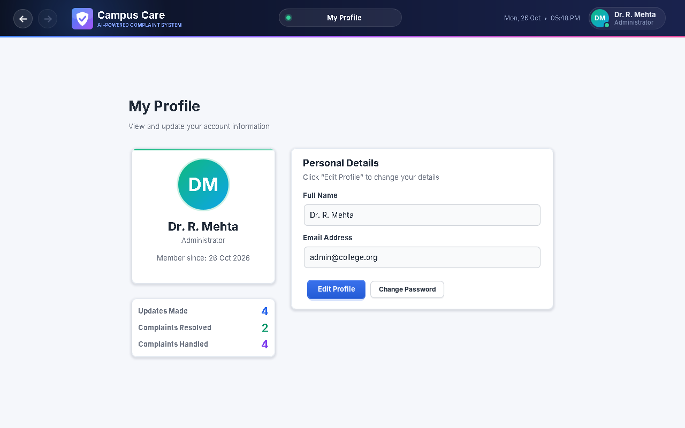

# 🏫 Campus Care

**An AI-powered complaint management system for colleges, hostels and PGs.**

Students raise complaints (water, electricity, WiFi, mess, cleaning…), the app
suggests the category and priority automatically, the admin assigns each
complaint to the right department, and everyone can track it until it is fixed.

Built with **Java Swing** and **MySQL**.


---

## 📸 Screenshots

| Home | Login |
|---|---|
|  |  |

| Student dashboard | New complaint with AI suggestion |
|---|---|
|  |  |

| My complaints | Admin dashboard |
|---|---|
|  |  |

| Analytics | Profile |
|---|---|
|  |  |

---

## ✨ Features
- 🎨 Default, Light and Dark themes (button in the top bar)

**For students**
- Register and log in securely
- Submit a complaint with a photo
- 🤖 **AI suggestion** – type in English or Hinglish (*"paani nahi aa raha"*) and the
  app fills in the category and priority by itself
- Track every complaint with its full timeline and admin remarks
- See which department the admin has assigned
- Rate the work (1–5 ⭐) after the complaint is resolved
- Withdraw a complaint before work starts
- Track a complaint **without logging in** (complaint ID + email)
- Edit profile and change password

**For admins**
- See all complaints with search and filters
- Assign each complaint to a department (Plumbing, IT Cell, Mess Committee…)
- Update status (Submitted → In Progress → Resolved / Rejected) with remarks
- ⏰ **Deadline tracking** – late complaints are marked **Overdue**
  (Urgent 1 day, High 2, Medium 4, Low 7 days)
- 📊 **Analytics** – charts, resolution rate, average time, student ratings, AI accuracy
- Export to Excel (CSV) and a printable monthly report

---

## 🚀 How to run

**You need:** Java 21, MySQL 8, and VS Code (or any Java IDE).

1. **Download** this project (green **Code** button → **Download ZIP**) and extract it.

2. **Start MySQL** on your computer.

3. **Add your database password**
   - Make a copy of `db.properties.example`
   - Rename the copy to `db.properties`
   - Open it and write your MySQL username and password

4. **Add the MySQL driver**
   - Download **MySQL Connector/J** (Platform Independent ZIP) from
     https://dev.mysql.com/downloads/connector/j/
   - In VS Code: **Java Projects → Referenced Libraries → +** and choose the
     `mysql-connector-j-*.jar` file

5. **Run** `src/Main.java`

That's it. The app creates the database and all tables by itself the first time.
Register an admin and a student from the app to start using it.

---

## 📁 Project structure

```
campus-care/
├── src/                     all Java code (run Main.java)
│   ├── Main.java            starts the app
│   ├── MainFrame.java       main window, navigation (back / forward)
│   ├── Welcome.java         home screen
│   ├── Login / Register     student login and sign-up
│   ├── AdminLogin / AdminRegister
│   ├── StudentDashboard.java
│   ├── SubmitComplaint.java new complaint + AI suggestion
│   ├── MyComplaints.java    student's complaints, rating, withdraw
│   ├── TrackComplaint.java  track without login
│   ├── AdminDashboard.java  manage, assign, update complaints
│   ├── AdminAnalytics.java  charts and monthly report
│   ├── Profile.java         my profile
│   ├── SmartClassifier.java the AI (keywords + machine learning)
│   ├── DatabaseSetup.java   creates / upgrades tables
│   ├── DBConnection.java    reads db.properties
│   ├── PasswordUtil.java    secure password hashing
│   └── Theme.java, UI.java, Charts.java   design and charts
├── screenshots/
├── database.sql             table structure (for reference)
├── db.properties.example    copy this to db.properties
└── README.md
```

---

## 🤖 How the AI works

`SmartClassifier.java` reads the complaint text and decides the category in two ways:

1. **Keyword rules** – words like *paani, nal, leakage* → Water; *wifi, net* → Internet
2. **Machine learning** – a **TF-IDF + Logistic Regression** model, written in plain
   Java (no external library). It learns from example complaints and from every
   complaint saved in the database.

Priority comes from urgent words: *fire, spark, current lag raha* → **Urgent**;
*leakage, power cut, food poisoning* → **High**.
When an admin corrects a category, the model learns from it.

---

## 🔒 Security

- Passwords are never stored as plain text – they are salted and hashed (SHA-256).
- All database queries use prepared statements (safe from SQL injection).
- The database password lives only in `db.properties`, which is **not uploaded**
  to GitHub (see `.gitignore`).
